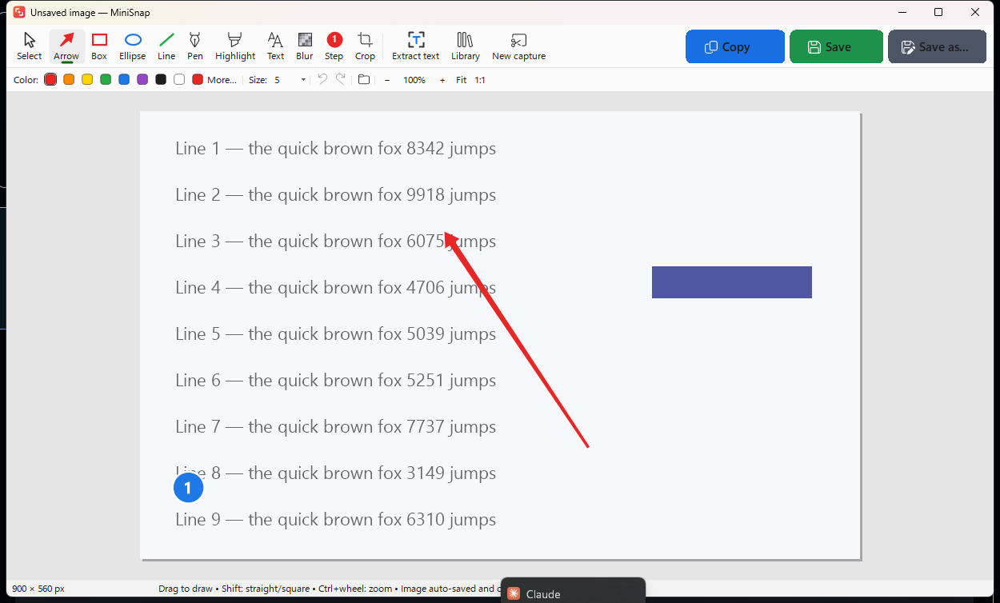
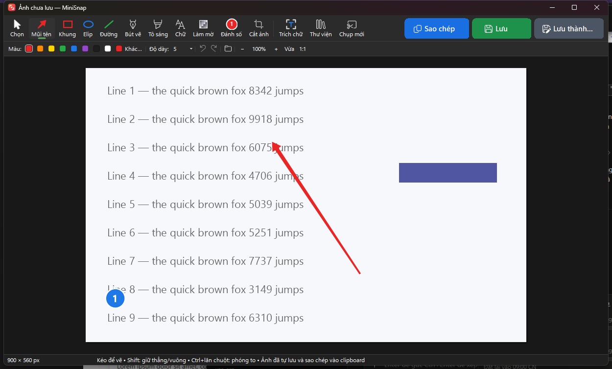
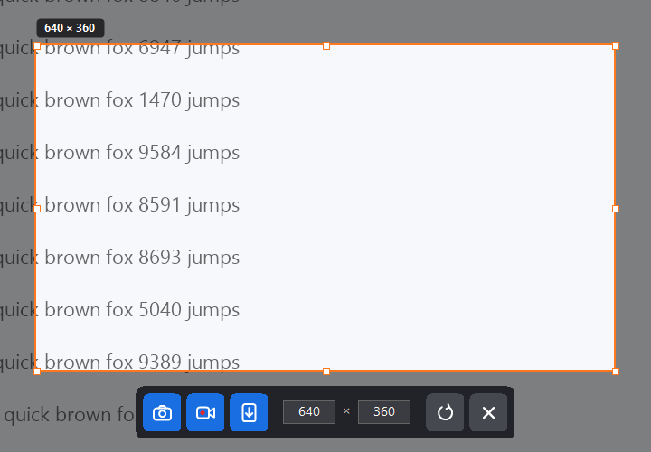
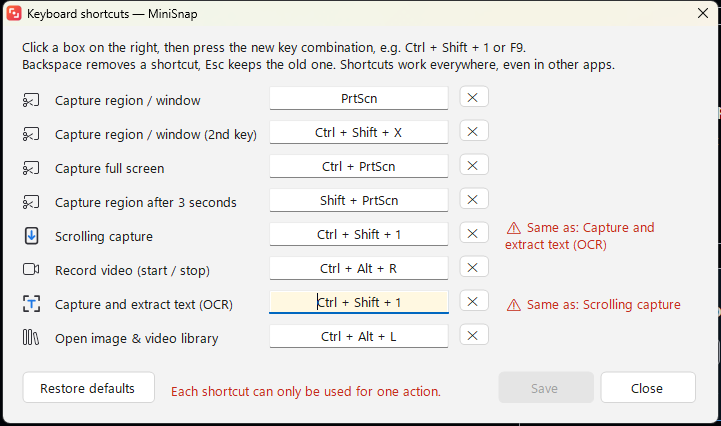

# MiniSnap

**Free, open-source screen capture for Windows and macOS** — screenshots, annotations, scrolling capture, screen recording and text extraction (OCR). Inspired by tools like Snagit, written from scratch, MIT-licensed.

**Phần mềm chụp màn hình miễn phí, nguồn mở cho Windows và macOS** — [đọc tiếng Việt bên dưới](#tiếng-việt).



| Dark mode | After selecting an area |
|---|---|
|  |  |

## Features

| | Windows | macOS |
|---|---|---|
| Capture a region, a window (hover + click) or the full screen, with magnifier | ✅ | ✅ |
| All-in-one: after selecting an area, pick **screenshot, video or scrolling capture**; resize the area or type an exact size | ✅ | ✅ |
| Annotate: arrow, box, ellipse, line, pen, highlight, text, blur, step numbers, crop, undo/redo | ✅ | ✅ |
| Big one-click **Copy / Save / Save as** buttons; every capture is auto-saved and copied | ✅ | ✅ |
| Scrolling capture of long pages (sticky headers/footers handled) | ✅ | ✅ |
| Screen recording to MP4 (H.264) with pause/resume | ✅ | ✅ |
| Text extraction (OCR) using the OS's built-in engine — offline | ✅ | ✅ |
| Library with thumbnails, grouped by date, search, drag-out | ✅ | ✅ |
| Customizable global keyboard shortcuts | ✅ | ✅ |
| English and Vietnamese, switchable from the tray / menu bar | ✅ | ✅ |
| Modern look: Windows 11 style (Mica title bar, light/dark, Fluent icons) · Liquid Glass on macOS 26 | ✅ | ✅ |
| Check for updates from GitHub Releases, one-click download and install (SHA-256 verified) | ✅ | ✅ (download) |

> **macOS status:** the macOS version was written without access to a Mac. It is compiled by CI on every push but has not yet been tested by hand — bug reports are very welcome.

## Download

Get the latest build from **[Releases](https://github.com/kingrubic/minisnap/releases)**:

- **Windows 10/11:** `MiniSnap-Setup.exe` — per-user install, no admin rights. The installer is not code-signed yet, so SmartScreen may warn: click *More info → Run anyway*.
- **macOS 14+:** `MiniSnap-macOS.zip` — unzip, then right-click `MiniSnap.app` → *Open* the first time (the app is not notarized). Grant *Screen Recording* (and *Accessibility* for scrolling capture) when asked.

See the [Code signing policy](#code-signing-policy) and the [Privacy policy](PRIVACY.md).

## Code signing policy

Free code signing provided by [SignPath.io](https://signpath.io), certificate by [SignPath Foundation](https://signpath.org).

- Windows binaries (`MiniSnap.exe`, `MiniSnap-Setup.exe`) are built from this repository by GitHub Actions ([build.yml](.github/workflows/build.yml)) and only releases built that way are signed. Releases published before signing was set up are unsigned.
- Team roles:
  - **Committers and reviewers:** [@kingrubic](https://github.com/kingrubic) (Nguyễn Năng Quốc Bảo)
  - **Approvers:** [@kingrubic](https://github.com/kingrubic) (Nguyễn Năng Quốc Bảo) — every release is approved manually before it is signed.
- Privacy: this program will not transfer any information to other networked systems unless specifically requested by the user or the person installing or operating it, except the optional daily update check described in the [Privacy policy](PRIVACY.md), which can be turned off.

## Default shortcuts

| Action | Windows | macOS |
|---|---|---|
| Capture region / window | `PrtScn` (also `Ctrl+Shift+X`) | `⌥⇧2` |
| Capture full screen | `Ctrl+PrtScn` | `⌥⇧1` |
| Capture after 3 seconds | `Shift+PrtScn` | `⌥⇧3` |
| Scrolling capture | `Ctrl+Alt+S` | `⌥⇧S` |
| Record video (start/stop) | `Ctrl+Alt+R` | `⌥⇧R` |
| Capture & extract text | `Ctrl+Alt+O` | `⌥⇧O` |
| Library | `Ctrl+Alt+L` | `⌥⇧L` |

All shortcuts can be changed in **Keyboard shortcuts…** from the tray / menu-bar menu.



## Building from source

- **Windows** — no SDK needed; uses the C# compiler that ships with Windows (.NET Framework 4.8):
  ```powershell
  powershell -ExecutionPolicy Bypass -File windows\build.ps1
  ```
  Produces `windows\bin\MiniSnap.exe` and `windows\bin\MiniSnap-Setup.exe`. See [windows/README.md](windows/README.md).
- **macOS** — Xcode 15+ command-line tools:
  ```bash
  bash macos/build.sh
  ```
  Produces `macos/dist/MiniSnap.app` and `MiniSnap-macOS.zip`. See [macos/README.md](macos/README.md).

GitHub Actions builds both on every push; pushing a tag like `v1.3.0` publishes a release with both downloads.

## Project layout

```
windows/   C# WinForms app + installer (src/, installer/, build.ps1)
macos/     Swift / AppKit app (Swift Package) + build.sh
docs/      screenshots for this README
```

## Contributing

Issues and pull requests are welcome — especially testing on macOS, new translations (add a column to `windows/src/Strings.cs` / the macOS strings file), and bug fixes.

## Author

**Nguyễn Năng Quốc Bảo** — [nnqbao@gmail.com](mailto:nnqbao@gmail.com) · [github.com/kingrubic/minisnap](https://github.com/kingrubic/minisnap)

## License

[MIT](LICENSE) — free for personal and commercial use.

---

## Tiếng Việt

MiniSnap là phần mềm chụp màn hình **miễn phí, nguồn mở (giấy phép MIT)** cho Windows và macOS:

- Chụp vùng, cửa sổ (rê chuột rồi bấm) hoặc toàn màn hình, có kính lúp.
- Chọn vùng xong sẽ hiện thanh nhỏ để chọn **chụp ảnh, quay video hay chụp cuộn**; kéo chỉnh vùng hoặc nhập kích thước chính xác.
- Chú thích: mũi tên, khung, elip, đường thẳng, bút vẽ, tô sáng, chữ, làm mờ, đánh số bước, cắt ảnh, hoàn tác / làm lại.
- Nút lớn **Sao chép / Lưu / Lưu thành…**; mọi ảnh chụp đều tự lưu và tự sao chép vào clipboard.
- Chụp cuộn trang dài, quay video màn hình ra MP4, trích chữ trong ảnh (OCR, chạy offline).
- Thư viện ảnh & video có ảnh thu nhỏ; tự đặt phím tắt; giao diện tiếng Việt / tiếng Anh, đổi nhanh ở menu khay.

**Tải về:** vào mục [Releases](https://github.com/kingrubic/minisnap/releases).
- Windows: chạy `MiniSnap-Setup.exe`. Nếu SmartScreen cảnh báo, bấm *More info → Run anyway*.
- macOS: giải nén `MiniSnap-macOS.zip`, lần đầu bấm chuột phải vào `MiniSnap.app` → *Open*.

**Đổi ngôn ngữ:** chuột phải vào biểu tượng MiniSnap ở khay hệ thống → *Ngôn ngữ / Language*.

**Cập nhật:** menu khay → *Kiểm tra cập nhật...*. App cũng tự kiểm tra mỗi ngày một lần và chỉ báo khi có bản mới.

**Tác giả:** Nguyễn Năng Quốc Bảo — nnqbao@gmail.com. Đây là phần mềm chụp ảnh, quay phim màn hình miễn phí, mã nguồn mở dành cho mọi người.

**Lưu ý:** bản macOS được viết mà không có máy Mac để thử; CI build được nhưng chưa chạy thử thật. Rất mong mọi người báo lỗi.

Hướng dẫn chi tiết cho Windows (tiếng Việt): [windows/README.md](windows/README.md).
